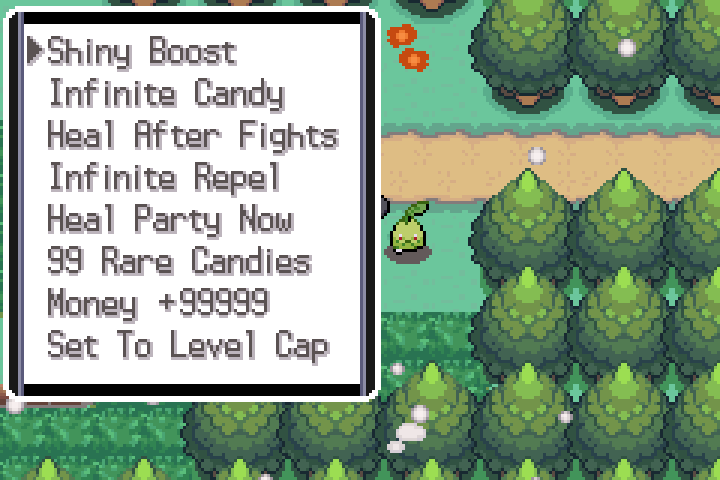
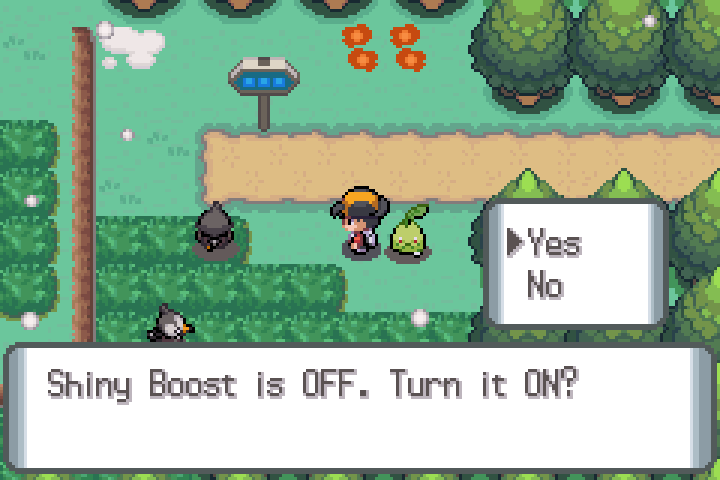
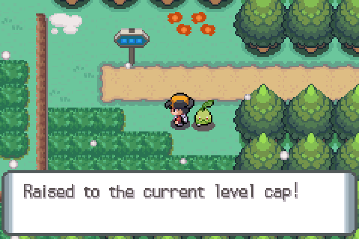

# Cheat Device

A small in-game menu of cheats for **Pokémon Azoth** (English translation).

- **River Edition: built in from v0.4 on.** Nothing to install; press SELECT + START on the map. River v0.3 and earlier do not have it.
- **Translation betas: no cheat patch is released.** An earlier separate "+ Cheats" add-on (`cheats-v1`) was withdrawn because its menu did not display properly (see below). Builders can still make a translation build with the menu using `RHT_CHEATS=1` (see the technical notes).

> This is only a **translation done with Claude** (plus fan-made additions by River). The hack, its name and its content belong to its
> original authors. The Cheat Device is an unofficial add-on and is not part of the original game.

## Install

**River Edition v0.4 or later: nothing to install**, the cheats are part of the River patch. Your existing saves keep working: the cheats' on/off switches are extra flags that are simply off in an old save. (Save states are tied to one build; make a normal in-game save.)

**Why the old add-on was withdrawn:** the game can only draw a menu window for lists of up to 8 entries; the add-on's menu had 9 and collapsed to one unreadable row. The menu now has 8 entries (B closes it) and `scripts/cheats_build.py` refuses to build a longer one.

## Open the menu

In the overworld (walking around, no text box or menu open) press **SELECT + START together**. On a keyboard in mGBA that is Backspace + Enter.
The menu appears at the top left. Choose an entry with the D-pad and **A**; **B** closes the menu.

| The menu | A switch asks first | Set To Level Cap |
|---|---|---|
|  |  |  |

## What each entry does

Entries with an on/off switch show their current state when you pick them ("Shiny Boost is OFF. Turn it ON?") and keep it in your save.

| Entry | Switch | What it does |
|---|---|---|
| **Shiny Boost** | yes | Pokémon created under your trainer ID (wild encounters, gifts, eggs) are shiny 1 time in 16 instead of 1 in 8192. Trainer Pokémon are not affected. |
| **Infinite Candy** | yes | Rare Candies are not used up. Selling and tossing still work normally. |
| **Heal After Fights** | yes | Your whole party (HP, PP, status) is healed when a battle ends: win, lose, flee or catch. |
| **Infinite Repel** | yes | Repel never runs out. It behaves like a normal Repel, so wild Pokémon stronger than your lead can still appear. |
| **Heal Party Now** | no | Heals the party anywhere, as often as you like (a Poké Vial that never runs dry). |
| **99 Rare Candies** | no | Adds 99 Rare Candies to your bag (Training pocket). |
| **Money +99999** | no | Adds ¥99,999. |
| **Set To Level Cap** | no | Pick a party Pokémon; it is raised to the level cap for your current number of badges. It is never lowered. |

### Level cap

The cap is the highest level on the next gym leader's team, by number of badges (the eight badge flags `0x820`-`0x827`):

| Badges | 0 | 1 | 2 | 3 | 4 | 5 | 6 | 7 | 8 |
|---|---|---|---|---|---|---|---|---|---|
| Cap | 9 | 16 | 23 | 30 | 37 | 39 | 44 | 52 | 64 |

(Falkner, Bugsy, Whitney, Pryce, Chuck, Jasmine, Clair, Morty, then the Elite Four's Lance. The leaders are taken in ascending level order, so
it does not matter in which order you fight them.) The Pokémon's experience and stats are recalculated; it does not learn moves or evolve
until its next level-up. If you find a cap that is wrong for your game, tell us (see below); the table is `data/cheats_levelcaps.json`.

## Report problems

Use the project's bug tracker (the link is in the release notes) and say which River version you use.

## Technical notes (for contributors)

Built into every `RHT_EDITION=river` build, and into the translation only with `RHT_CHEATS=1` (`scripts/edition.py`); `python3 scripts/build_editions.py` builds the three variants and `python3 scripts/dist.py --cheats N`
packages the add-on. Code: `scripts/native/cheats.s` (Thumb, linked into the free pool) and `scripts/cheats_build.py` (menu script, the 66th multichoice
list, patches with byte assertions). Switch flags: `0x13A8` shiny, `0x13A9` candy, `0x13AA` heal, `0x13AB` repel; `0x13AC`-`0x13AF` are kept.

| Feature | Hook |
|---|---|
| Menu hotkey and Infinite Repel | wrapper on the literal of the `ProcessPlayerFieldInput` trampoline (0x0806CACC): SELECT+START starts the menu script; every free frame it keeps var `0x4020` (repel steps) at 255 while the switch is on |
| Shiny Boost | stub jumped to from the hack's `CreateBoxMon` (0x09D09BC8), player-OT branch; forces the personality's high half so `tid^sid^hi^lo < 8` and re-stores it. Wild encounters arrive with a *fixed* personality (the stub used to skip those, #139): for them it searches 2048 candidates for a shiny value that keeps `personality % 25` (nature), gender and ability slot (only bits 8-31 change) |
| Infinite Candy | the `RemoveBagItem` literal of the Rare Candy flow (0x09D44884) -> `candy_wrap` |
| Heal After Fights | both literals of `gBattleMainFunc = ReturnFromBattleToOverworld` (0x15A68, 0x15B2C) -> `heal_wrap` (`HealPlayerParty`) |
| Set To Level Cap | `cap_apply` (called by `callnative`): badge count -> `caps[]`, EXP from the hack's experience table, `CalculateMonStats` |
| Menu | `multichoice` list id 65: the vanilla table copied with one more entry, its two literals (0x9CB58, 0x9CFD4) repointed |

Verified in mGBA on a translation save and a River save: menu opens; switches toggle and show their state; 222/4000 shiny creations with the switch on vs
1/4000 off; Rare Candy stays at x99 after use; HP 1 -> 77 after fleeing a wild battle; repel var held at 255 while walking; Heal Party Now; money gift;
level 26 -> 30 with 3 badges, and the "already at cap" reply.
