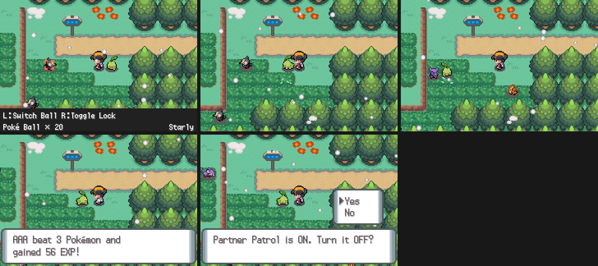
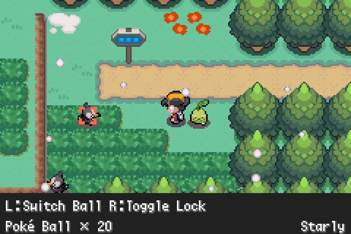
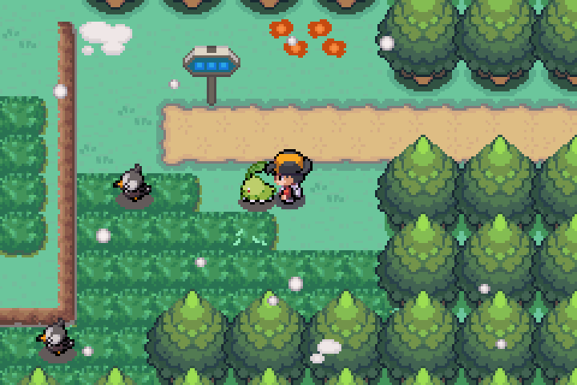
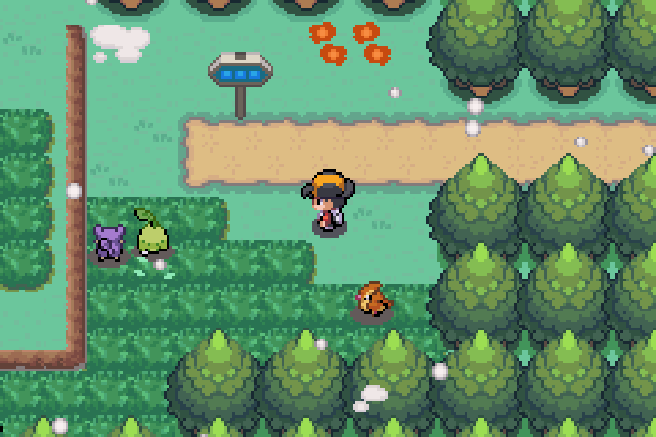
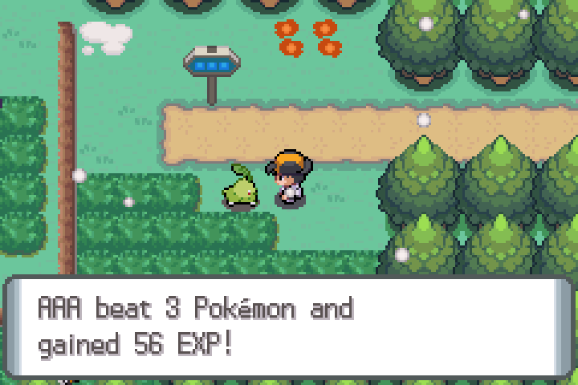
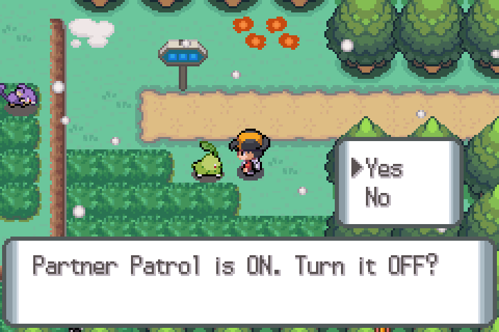

# Partner Patrol (River Edition v0.3+)

Your walking partner can now go out on its own, find the wild Pokémon in sight, battle them for you and bring back the experience and the drops.

> This is a fan-made addition by River, with Claude, to the River Edition of the English translation of Pokémon Azoth. The hack, its name and its content
> belong to their original authors; the Partner Patrol is not part of the original game. Do not report problems with it to them.

## What you need

- **The River Edition v0.3 or later.** The patrol is built into every River build. The translation betas do not have it.
- **Quick Catch**, the hack's own overworld catching mode: standard button mode (L must not be mapped to A) and at least one Poké Ball in the bag.
- **A Pokémon walking behind you.** The patrol sends *that* Pokémon (the one you see following you).
- Wild Pokémon in sight (Quick Catch only shows the visible ones).

## How to use it

1. Press **L** on the map to open Quick Catch (aim at a visible Pokémon, as usual).
2. Press **SELECT**. Quick Catch closes and your partner runs to the Pokémon you were aiming at.

   | Aiming | Walking | Striking |
   |---|---|---|
   |  |  |  |

3. The partner hops at the target (the fight happens there), the target disappears, and it goes on to the next one nearby. You can keep walking, or stand still.
4. When it is done it comes back to you and tells you what happened:

   

**B** calls the partner back at any time while it is walking. Nothing else is needed.

## What the partner does

- It picks the **nearest** visible Pokémon (within 12 tiles of you), walks around obstacles to it, fights it, then looks for the next one. Up to **10 Pokémon per patrol**
  (see Settings). It stops when there is nothing left in range, when it cannot get closer, when it is worn out, when you press B, or if you change maps.
- **The fight has no moves.** It is decided by types, like the auto-battles in Scarlet/Violet: each side attacks with its best own type (with the same-type bonus) against the
  other's types, using the game's type chart, so a Grass-type partner does well against Water and badly against Flying. Level, stats and speed count the usual way.
  Abilities, items and weather do not.
- **It costs HP.** Every fight hurts the partner. When its HP falls below 40% it retreats and the patrol ends ("is worn out and came back"); a partner that starts below 40% refuses ("is too hurt to fight").
  It never faints from a patrol (it retreats with at least 1 HP). Healing is up to you.
- **Higher-level Pokémon are much harder.** There is no level cap rule: the fight itself is the limit.
- **A shiny stops it.** Whether a wild Pokémon is shiny is decided when it is created, so the patrol creates each target before fighting it. If it comes out shiny the partner **does not fight it**:
  the patrol ends, tells you ("This Pokémon is shiny! ... holds it still for you") and starts a real wild battle with that very Pokémon so you can catch it.
- Nothing is caught and the Pokédex is not changed.

## What you get

For every Pokémon the partner beats (the same drop rule as a Quick Catch win):

| What | How |
|---|---|
| **Experience** | The partner gains `base EXP yield x level / 7` (it alone). Level-ups teach the moves of that level. **Evolution is left to the game**: the partner is flagged and evolves after your next real battle, as if it had levelled up in one. |
| **One drop** | 20%: an **Exp. Candy** (XS below Lv 20, S below 40, M below 60, L below 80, XL from 80, by the target's level). 30%: one of ten **Berries**. 50%: **EV Feathers**, with the hack's own rules (Power items, the doubling item, the Exp. Share multiplier; the EV switch does not matter). |
| **Held items** | What the species can hold: the common item 50%, the rare one 5% (always, if both are the same). |

At the end the partner reports everything in one go: how many Pokémon it beat and the total EXP, any level-up and new moves, then each item found ("Found Muscle Wing x3!"),
or "No room in the bag for X!" when the bag is full. The very first time, a short tip explains B and the settings.

## Settings

Hold **L and R** and press **SELECT** anywhere on the map. Two questions, remembered in your save:

- **Partner Patrol ON / OFF.** Off: SELECT in Quick Catch does nothing special.
- **Patrol size** (each "Make it ..." answer cycles normal, long, short): **short** = up to 4 Pokémon within 8 tiles, **normal = 10 within 12**, **long** = up to 20 within 16.

## Limits and good to know

- It only works where Quick Catch works. With nobody walking behind you (surfing, on the bike) SELECT is ignored.
- If the way to a target is blocked the partner gives up after a few tries ("couldn't get close") and walks back.
- The River Edition also has the Cheat Device (from v0.4): inside Quick Catch SELECT is the patrol; the cheat menu stays on SELECT + START outside it.
- Old saves work: the patrol's settings start on their defaults.
- Please report problems with "River Edition v0.3" in the title, with your emulator and an in-game `.sav` from just before.

## How it works (for the curious)

The patrol is a small program added to the ROM (about 5 KB), started by the SELECT key while Quick Catch is open:

1. It reads the aimed target from Quick Catch (its species and level, stored in the visible Pokémon's overworld object) and finds your partner: the party member whose species is the walker's sprite.
2. A background task takes over the walker. The hack's own follower code is told to leave it alone for the duration; the patrol walks it with the game's normal movement commands, planning a route over a
   13 x 13 window around it (it asks the game whether each neighbouring tile can be entered) and re-planning at every step, so it can chase a target that moves.
3. When adjacent it faces the target and hops, builds the real Pokémon with the game's own creation routine (so stats, types and shininess are exact), and runs the typed fight.
4. The experience, level-ups, drops and held items are applied with the game's own functions (`SetMonData`, `CalculateMonStats`, `AddBagItem`, the hack's Feather routine); the target is removed the way a Quick Catch throw removes it.
5. At the end the partner walks back and the follower code gets the walker again. Every way out (a map change, a lost target, a timeout, a block, B) clears the "patrol owns the walker" flag.

Memory safety: all of the patrol's state lives in one 512-byte block of an unused buffer (checked with write watchpoints over a full session); the walker is moved only through the game's own functions; object indices are
range-checked before use; and the hook that silences the follower code also checks that the patrol's task is really alive, so a stale flag can never freeze your partner.

Tested in the emulator on 25 maps with wild encounters (routes, cave floors): every patrol ended cleanly. Design, milestones, addresses and the test log are in [PARTNER_PATROL_SPEC.md](PARTNER_PATROL_SPEC.md);
the code is `scripts/native/patrol.c`, `scripts/native/patrol.s` and `scripts/patrol_build.py`; the sweep is `scripts/patrol_sweep.py`.
